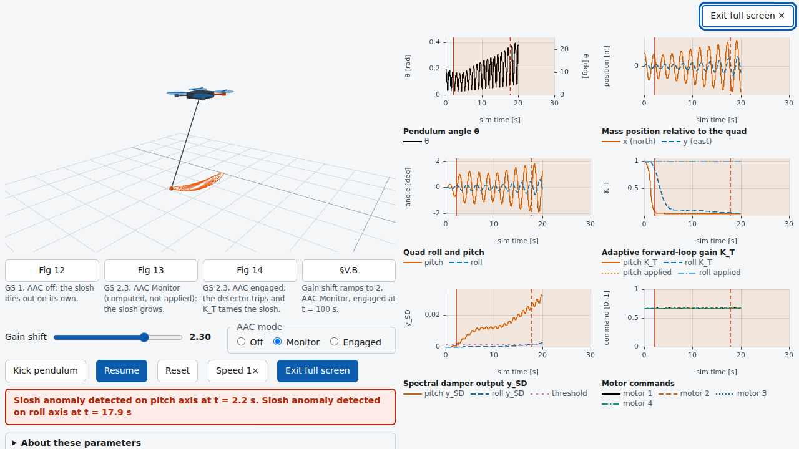

# slosh-sim: a fuel-slosh testbed you can fly in the browser

An interactive simulation of a quadrotor carrying a hanging mass that behaves like sloshing rocket
propellant, and of the Adaptive Augmenting Control (AAC) that detects and suppresses the slosh
instability. It runs entirely in the browser as a `<slosh-sim>` Web Component, written for a blog
post on [candresdu.github.io](https://candresdu.github.io/blog/).



The simulation reconstructs the experiment of the paper cited in [docs/references.md](docs/references.md),
from its published dynamics and physical parameters. The paper does not give the controller gains or
the AAC tuning, so those are designed, assumed or tuned here, and labelled as such in
[blog/reconstruction.md](blog/reconstruction.md). The simulation reproduces the paper's results
qualitatively; it is not the original testbed's code or data. The reasoning behind the modelling
choices is in the blog post and in `reports/`.

## What is in it

- A 6-degree-of-freedom quadrotor with a quaternion attitude and a hanging point-mass pendulum,
  integrated with fixed-step RK4 at 1 kHz; motors with a first-order lag.
- Two nested PD loops per horizontal axis, a **gain shift** that drives the slosh mode unstable on
  purpose, and the AAC: a spectral damper that detects oscillation near the slosh frequency and
  lowers the forward-loop gain.
- One continuous story flight: Nominal, then Gain shift (the detector trips), then AAC engaged.
  The reader steers it with three regime buttons, or replays the paper's sequence.
- Live charts of the pendulum angle, the AAC gain and the detector signal (all six charts in full
  screen), a light and dark theme that follows the host page, and full screen.

## Repository layout

| Folder | Contents |
|---|---|
| `python/` | Reference model, controller design and golden-trace export (uv project, package `slosh`) |
| `web/` | TypeScript simulation core and the `<slosh-sim>` Web Component (Vite, vitest, Playwright) |
| `shared/` | Parameters, presets and JSON schemas used by both implementations |
| `golden/` | Golden traces from the Python model that the TypeScript core must match |
| `blog/` | The blog post, its model-generated figures and the al-folio integration files |
| `docs/` | References |
| `reports/` | Design and verification reports (margins, AAC tuning, cross-checks) |

## Build and test

### Python

Requires [uv](https://docs.astral.sh/uv/) and Python 3.11 or newer.

```sh
cd python
uv sync                       # install dependencies
uv run pytest                 # tests
uv run ruff check .           # lint
uv run ruff format --check .  # format check
```

### Web

Requires Node 22.

```sh
cd web
npm ci               # install dependencies
npm run typecheck    # tsc --noEmit for both tsconfigs
npm run lint         # eslint
npm test             # vitest run
npm run build        # vite build: web/dist/slosh-sim.js, one ES module with Three.js and uPlot bundled
npx playwright install --with-deps   # once: Chromium, Firefox and WebKit
npm run e2e          # Playwright + axe on all three browsers (builds and serves with vite preview)
```

## Embedding

The build produces one ES module. Load it once and place the element:

```html
<script type="module" src="/assets/js/slosh-sim.js"></script>
<slosh-sim>
  
</slosh-sim>
```

With no attributes it starts in story mode. Optional attributes: `preset` (`story`, `fig12`, `fig13`,
`fig14` or `vb`), `autoplay`, `theme` (`light` or `dark`; omitted, it follows the page's
`html[data-theme]`) and `fullscreen-button="false"`. The fallback image is shown only when WebGL is
unavailable.

For an [al-folio](https://github.com/alshedivat/al-folio) Jekyll site there is a ready-made include
and a release checklist in [blog/integration/README.md](blog/integration/README.md).

## Citation

The testbed and the AAC concept are the work of the authors of the paper this simulation is based on:

> J. Pei, A. Puetz, C. Duarte, L. Miller and P. Rothhaar, "Suppression of Nonlinear Rotary Slosh
> Dynamics using the SLS Adaptive Augmenting Control System: Demonstration on a Quadcopter Testbed",
> AIAA Scitech 2019 Forum, 2019. DOI: [10.2514/6.2019-0114](https://doi.org/10.2514/6.2019-0114).

A BibTeX entry is in [docs/references.md](docs/references.md). This repository cites the paper only;
it does not include the paper, its figures or excerpts from it.

## License

MIT, see [LICENSE](LICENSE).
